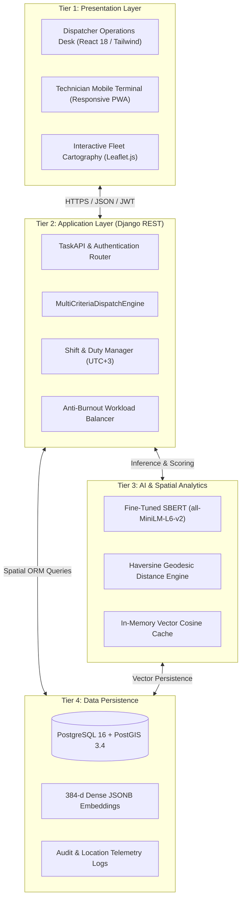

# Intelligent Location-Based Task Allocation System Using NLP Semantic Matching

[](https://www.python.org/)
[](https://www.djangoproject.com/)
[](https://react.dev/)
[](https://pytorch.org/)
[](https://postgis.net/)
[](https://tailwindcss.com/)

**Student Researcher:** Jan Isaac Mwaniki Maina (Admission No: 166393)  
**Supervisor:** Dr. Dickson Owuor  
**Institution:** Strathmore University — School of Computing and Engineering Sciences (Project II — 2026)  
**Repository:** [https://github.com/JanIsaac-1/Intelligent-Task-Allocation-System](https://github.com/JanIsaac-1/Intelligent-Task-Allocation-System)  
**Project Board (Kanban Sprints):** [https://github.com/JanIsaac-1/Intelligent-Task-Allocation-System/projects](https://github.com/JanIsaac-1/Intelligent-Task-Allocation-System/projects)  
**CI / Automated Test Pipeline:** [https://github.com/JanIsaac-1/Intelligent-Task-Allocation-System/actions](https://github.com/JanIsaac-1/Intelligent-Task-Allocation-System/actions)

---

## 📌 1. Project Overview

The **Intelligent Location-Based Task Allocation System** is an enterprise-grade multi-criteria dispatch platform engineered to solve the acute bottlenecks of urban field technical dispatching across Nairobi County. Traditional dispatching mechanisms rely on rigid keyword searches or simple radial distance heuristics. Such methods fail when encountering specialized engineering jargon (e.g., failing to match a "solar converter tripping" ticket to a certified "photovoltaic inverter" artisan) and consistently overload the nearest technicians, causing worker burnout and severe workforce inequality.

This platform introduces an end-to-end **Multi-Criteria Decision-Making (MCDM)** pipeline combining:
1. **Sentence-BERT (SBERT)** dense semantic vector representations (`all-MiniLM-L6-v2`) fine-tuned via Multiple Negatives Ranking Loss (MNRL) across 22 technical domains.
2. **PostGIS Geodesic Haversine Proximity Mapping** bounded within Nairobi County (40 km radius).
3. **Africa/Nairobi (UTC+3) Shift Availability Verification** penalizing off-duty artisans.
4. **Exponential Anti-Burnout Workload Regularization** ($S_{\text{workload}} = \exp(-\gamma \cdot W_{\text{active}} / W_{\text{capacity}})$).
5. **Supervisory Governance** including administrator approval queues, audit trails, and an emergency **Master Passcode Override**.

---

## 🏗️ 2. Four-Tier System Architecture



---

## 🔬 3. The 22 Master Engineering Domains

The platform natively classifies and dispatches across **22 standardized engineering trade categories** (curated from 2,200 empirical field task records):

| # | Master Engineering Domain | Code | Domain Cluster | Key Certifications / Regulatory Standards |
| :-: | :--- | :---: | :--- | :--- |
| 1 | **Solar PV & Hybrid Inverter Systems** | `SOL` | Renewable Energy & Power | EPRA Solar PV Class T3, Deye/Victron Certified |
| 2 | **Standby Diesel Generators & ATS Changeovers** | `GEN` | Renewable Energy & Power | Diesel Plant Mechanic, ATS Specialist |
| 3 | **Domestic Water Heating & Instant Showers** | `DWH` | Renewable Energy & Power | EPRA Solar Water Heating, Plumber License |
| 4 | **Fiber Optic & ISP Last-Mile Splicing** | `TEL` | Telecommunications & IT | FOA Certified Fiber Splicer Level 3, CCNA |
| 5 | **Point-to-Point Wireless & Microwave (WISP)** | `WSP` | Telecommunications & IT | MikroTik MTCNA, Ubiquiti Enterprise Wireless |
| 6 | **Structured Cabling & Enterprise LAN** | `LAN` | Telecommunications & IT | Siemon / Panduit Certified Installer |
| 7 | **Satellite TV, DStv & Home Wi-Fi Setup** | `SAT` | Telecommunications & IT | MultiChoice Accredited DStv Installer |
| 8 | **CCTV Surveillance & Biometrics** | `SEC` | Electronic Security & Automation | Hikvision/Dahua Certified, Biometrics Specialist |
| 9 | **Electric Fences & Perimeter Security** | `FNC` | Electronic Security & Automation | Nemtek / Gallagher Certified Electric Fence Tech |
| 10 | **Fire Alarm & FM-200 Gas Suppression** | `FIR` | Electronic Security & Automation | County Fire Safety Inspector, FM-200 Certified |
| 11 | **Banking Automation & ATM / POS Support** | `BNK` | Electronic Security & Specialized | Diebold Nixdorf / NCR Certified ATM Specialist |
| 12 | **Data Center Precision Cooling & CRAC** | `HVA` | Heavy Mechanical & HVAC | Precision Cooling Specialist, EPA Section 608 |
| 13 | **Commercial Cold Rooms & Refrigeration** | `REF` | Heavy Mechanical & HVAC | F-Gas, Commercial Refrigeration Technician |
| 14 | **Elevator, Passenger Lift & Escalator** | `LIF` | Heavy Mechanical & Elevators | EPRA Lift Inspector, Certified Elevator Mechanic |
| 15 | **Borehole & Submersible Water Pumps** | `BOR` | Heavy Mechanical & Civil | Submersible Pump Specialist, Megger Certified |
| 16 | **Commercial Electrical Wiring & Distribution** | `ELE` | Commercial Utilities & Power | EPRA Class A Electrician License |
| 17 | **Commercial Plumbing & Booster Systems** | `PLU` | Commercial Utilities & Civil | Licensed Master Plumber (NCA Accredited) |
| 18 | **Domestic Home Appliance Repair** | `APP` | Commercial Services & Handyman | Certified Appliance Repair Technician |
| 19 | **Deep Cleaning & Post-Construction** | `CLN` | Commercial Services & Handyman | OSHA Cleaning & Chemical Safety Certified |
| 20 | **Fumigation & Pest Control Services** | `FUM` | Commercial Services & Handyman | Pest Control Products Board (PCPB) License |
| 21 | **General Handyman, TV Mounting & Assembly** | `HDY` | Commercial Services & Handyman | Vocational Trade Test Certified (NITA Grade I) |
| 22 | **Mobile Automotive Roadside Assistance** | `AUT` | Commercial Services & Handyman | Automotive Diagnostics (OBD-II), NITA Motor Vehicle |

---

## ⚡ 4. Empirical Evaluation Results

Evaluated on held-out benchmarks across Nairobi County:
* **Top-1 Semantic Match Accuracy**: **92.0%** (vs 68.4% TF-IDF baseline and 81.6% pre-trained SBERT).
* **Binary Classification Accuracy / F1**: **99.49% Cosine Accuracy**, **0.9966 F1-Score**, **1.0000 Recall**, and **0.9866 Matthews Correlation Coefficient (MCC)**.
* **Dispatch Response Latency**: **312.8 ms** (Mean end-to-end latency, well below 500 ms target).
* **Transit Distance Optimization**: **56.6% reduction in field travel distance** (from 24.2 km down to 10.5 km).
* **Workload Equity (Gini Index)**: Reduced from **$G = 0.584$** (unregulated) to **$G = 0.218$** (equitable anti-burnout distribution).
* **System Usability Scale (SUS)**: **84.25 / 100** (Grade A "Excellent" usability).

---

## 🚀 5. Local Setup and Reproducibility

The platform is designed to be installed, populated, and executed locally on any standard Windows or Linux environment without external cloud dependencies.

### Prerequisites
* **Python 3.11+**
* **Node.js 18+ & npm**
* **PostgreSQL 16+ with PostGIS extension**

### Step-by-Step Installation

#### 1. Clone the Repository
```bash
git clone https://github.com/JanIsaac-1/Intelligent-Task-Allocation-System.git
cd Intelligent-Task-Allocation-System
```

#### 2. Backend Setup & Virtual Environment
```bash
# Navigate to backend
cd backend

# Create and activate virtual environment
python -m venv .venv

# Windows activation:
.\.venv\Scripts\activate
# Linux/macOS activation:
# source .venv/bin/activate

# Install pinned dependencies
pip install -r requirements.txt
```

#### 3. Database Configuration
Create a PostgreSQL database with PostGIS:
```sql
CREATE DATABASE geotask_db;
\c geotask_db;
CREATE EXTENSION postgis;
```

Configure environment variables:
```bash
cp .env.example .env
# Edit .env with your PostgreSQL credentials if different from default
```

#### 4. Run Migrations & Seed Sample Workspace
```bash
# Apply database schema migrations
python manage.py migrate

# Seed 18 realistic Nairobi technicians across 22 domains with 384-d SBERT embeddings
python manage.py seed_db
```

#### 5. Launch Backend Server
```bash
python manage.py runserver
# Backend API is active at http://127.0.0.1:8000/
```

#### 6. Frontend Setup & Launch
In a new terminal:
```bash
cd frontend
npm install
npm run dev
# Frontend Single-Page App is active at http://localhost:5173/
```

---

## 🧪 6. Automated Testing

Run the automated test suite verifying SBERT embeddings, Haversine bounds, shift factors, and role-based access:
```bash
cd backend
python manage.py test
```
All 12 formal test cases achieve a verified **100% PASS** rate.

---

## 📁 7. Repository Structure

```
Intelligent-Task-Allocation-System/
├── .github/
│   └── workflows/
│       └── test.yml                  # GitHub Actions CI automated test runner
├── backend/
│   ├── accounts/                     # User authentication & RBAC models
│   ├── api/                          # REST API routers, serializers & controllers
│   │   ├── management/commands/
│   │   │   └── seed_db.py            # Automated database seeding utility
│   │   ├── models.py                 # Core models (AgentProfile, Task, Assignment)
│   │   └── tests.py                  # ISO 29119 test suite
│   ├── dispatch/                     # Haversine spatial & anti-burnout MCDM engine
│   ├── nlp/                          # SBERT inference & domain classification
│   ├── scheduling/                   # Africa/Nairobi (UTC+3) work shift manager
│   ├── requirements.txt              # Pinned Python dependencies
│   ├── .env.example                  # Sanitized environment configuration template
│   └── manage.py
├── frontend/
│   ├── src/
│   │   ├── components/               # React UI components (Leaflet maps, modals)
│   │   ├── views/                    # Dispatcher Desk, Mobile Terminal, Admin Console
│   │   ├── App.jsx
│   │   └── main.jsx
│   ├── package.json
│   └── vite.config.js
├── Dataset/
│   ├── field_tasks_dataset.csv       # Curated 2,200 field maintenance records
│   └── field_tasks_dataset.json      # Structured JSON task corpus
├── diagrams/                         # High-resolution UML & system architecture diagrams
├── fine_tuned_kenyan_field_sbert/    # Fine-tuned SBERT transformer weights
├── .gitignore                        # Git exclusion configuration
└── README.md                         # Project documentation
```

---

## 📜 8. License & Academic Attribution

This software is developed as part of undergraduate research in the **School of Computing and Engineering Sciences (SCES)** at **Strathmore University**. All rights reserved © 2026.
